# Research architecture

This foundation defines validated research records, YAML configuration and a
strategy interface. It contains no indicators, trading algorithms, downloads,
backtesting calculations, optimization, classifiers, predictive models, databases
or execution clients. Python 3.12 is the initial supported interpreter.

```mermaid
flowchart LR
    Sources[Historical and live market data] --> Data[Versioned point-in-time snapshots]
    Data --> Features[Shared observable features]
    Data --> Strategies[Independent strategies]
    Strategies --> Signals[Timestamped target exposures]
    Signals --> Simulation[Simulation with explicit costs]
    Simulation --> Performance[Observed strategy performance]
    Signals --> Storage[Research experiment artifacts]
    Performance --> Storage
    Features --> Regimes[Observable market-regime analysis]
    Features --> Selection[Adaptive strategy selection]
    Regimes --> Selection
    Performance --> Past[Only performance available at decision time]
    Past --> Selection
    Selection --> Allocation[Dynamic capital allocation]
    Allocation --> Risk[Portfolio risk management]
    Risk --> Paper[Paper trading]
    Paper --> Execution[Eventual controlled execution]
    Storage --> Labels[Research-only future outcome labels]
    Labels --> Validation[Walk-forward model development]
    Validation --> Selection
```

The diagram describes intended boundaries, including components not implemented
here. `config` loads settings; `contracts.py` defines shared records;
`strategies/base.py` defines the protocol and point-in-time replay helper.
Existing small package markers reserve data, backtesting, metrics, experiments,
validation and portfolio responsibilities. Features, regimes and selection can
become packages when their first implementations are needed.

## Causal market data

A `Market` identifies exchange, uppercase base/quote pair and timeframe (`1d` or
`4h`). A `Candle` carries source, dataset version and SHA-256 checksum through a
`DatasetReference`. Prices are positive and finite, volume nonnegative, OHLC
bounds consistent. Intervals are half-open `[open_time, close_time)` and must
span exactly the declared timeframe. Naive datetimes are rejected; aware
instants normalize to UTC in all records.

Incomplete candles may be stored, but cannot enter `MarketData`. A completed
candle cannot be available before its exclusive close. `available_at` is when
that particular dataset vintage became usable, which may be later than close.
A `MarketData` snapshot rejects data published after its `as_of` cutoff,
mismatched markets, duplicate, reversed or overlapping candles. Gaps are allowed;
future ingestion must investigate them rather than silently filling them.
Revisions require their actual publication time and a new dataset reference;
never backdate revised values to the original candle close.

These validations cannot establish that a vendor's declared availability time
is truthful. Ingestion must preserve source evidence. Checksums are references,
not verification that files exist or contain the claimed bytes.

## Strategy configuration and historical reconstruction

`StrategyConfig` contains the strategy identifier, implementation/configuration
version, market/timeframe and immutable named scalar parameters. Parameter names
are unique and sorted. `canonical_json()` uses sorted object keys and normalized
UTC; `identity` hashes that representation with SHA-256. Equivalent parameter
order produces the same identity. An experiment can include parameter variants
of the same strategy and separate market configurations; duplicate identities fail.

A strategy implements `config` and `generate(history) -> SignalBatch`. Evaluate
one configuration per market/timeframe; reuse the same implementation for other
markets. Generation must be deterministic, using only the supplied snapshot and
configuration, without a wall clock, ambient randomness, network access or order
submission. The protocol exposes no execution or optimizer capability. Python
protocols cannot sandbox arbitrary implementations or prove determinism; each
future strategy needs behavioral tests and a code review for hidden data access.

`reconstruct` passes ordered snapshots separately to the strategy, checks output
identity and requires each resulting decision to use that snapshot's cutoff.
Construct each snapshot using the vintage available at that instant. Do not
pass a full final dataset to a strategy and ask it to infer early decisions.
The helper does not download or calculate market data or implement a strategy.

`TargetExposure` carries strategy, market, last data close used (`data_through`),
decision time (`generated_at`), earliest execution eligibility (`effective_at`),
long-only fractional target weight and optional strength. Require
`data_through <= generated_at <= effective_at`. `SignalBatch` also checks that
the referenced candle was available at that decision time and that effective
timestamps are unique and chronological. A stored historical batch may contain
different decision timestamps; they need not equal the final batch cutoff.
Replay generation uses individual cutoffs to avoid exposing later data early.

Eligibility does not imply a fill at an already observed candle price. Future
simulation must specify executable prices and latency, conservatively using a
subsequent executable observation. Per-signal weights do not constrain aggregate
portfolio exposure; capital, turnover and concentration limits belong to risk
management and accounting.

## Decision inputs and subsequent outcomes

`MarketFeature` represents an observable named, versioned value, with source-data
and availability timestamps. A retrospective regime classification is not an
observable feature unless it can be reproduced using only information then
available. No indicator calculations or regime classifications exist yet.

`StrategyPerformance` records periodic gross/net returns, position, target
exposure, cash allocation, trading costs and drawdown. `shadow=True` marks
observed simulated performance for an inactive strategy. Availability must follow
the measurement period. Cash and costs are in the experiment's base currency;
returns and drawdowns are fractions, drawdown a nonnegative magnitude. Values
are supplied by future accounting, not calculated or reconciled here.

`DecisionInputs` accepts market history, observable features and already available
performance records. Availability is bounded by the decision cutoff. It has no
outcome field; unknown fields fail and `FutureOutcome` cannot validate as a
feature or performance record. Cross-market historical performance can be used
by a future selector, with its own market identity retained.

`FutureOutcome` is a separate research-only record referencing a full historical
decision. Future research code will join labels by the decision's canonical
identity, specify a forward half-open horizon beginning no earlier than execution
eligibility, and attach net returns/drawdowns only after the horizon completes
and the required data is available. Store labels separately from decision-input
artifacts. A future training builder may join them offline; live selection must
accept only `DecisionInputs`, never the joined training records. Purge labels
whose horizons overlap validation/test boundaries and embargo when appropriate.
No label generation or predictive dataset builder is implemented in this task.

## Experiments and research process

`ExperimentConfig` snapshots research settings and strategy configurations; its
identity includes parameters, markets, costs and seed. `ExperimentMetadata`
references that identity, full strategy configs, code revision, dataset sources,
versions/checksums, ordered nonoverlapping training/validation/test intervals,
optional seed, explicit cost assumptions and result artifacts. Failed runs must
record a failure reason; successful runs cannot carry one. Artifact experiment
identifiers must match. Persist the full experiment config, metadata, lockfile
and environment alongside artifacts in future orchestration, and verify hashes
when loading. No storage system or experiment execution is implemented here.

The planned research loop is:

1. Develop one algorithm with explicit, versioned parameters.
2. Reconstruct causal decisions from point-in-time snapshots.
3. Backtest with realistic fees, slippage and execution timing.
4. Capture decisions, costs and subsequent performance, including shadow runs.
5. Compare across cryptocurrencies and observable conditions.
6. Apply walk-forward training, validation and untouched forward tests.
7. Evaluate incremental contribution, correlations and turnover in a combined portfolio.
8. Build point-in-time research datasets for adaptive selection and capital allocation.

Fit preprocessing and parameter/model selection only within training folds.
Keep future outcome labels out of decision inputs. Avoid revised-data leakage,
full-sample normalization, same-bar fills and incomplete candles. Record both
successful and unsuccessful trials, account for multiple comparisons, test cost
and parameter sensitivity, and retain a final untouched holdout. Merely defining
nonoverlapping periods does not implement these safeguards or prove a strategy
is free of leakage or overfitting.

Selection and capital allocation remain separate from signal generation.
Portfolio risk management will enforce budgets and drawdown limits. Extensive
historical and forward testing, followed by paper trading, must precede any
controlled execution integration. Current config rejects live trading, leverage,
short selling and modes other than spot. No credentials are needed or stored.
