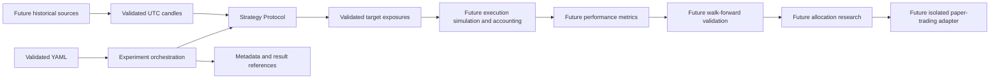

# Research architecture

The objective is reproducible comparison of eight algorithms across forty initial
configurations, prioritizing risk-adjusted returns and drawdown control. No
algorithm or performance evaluation is implemented in this foundation.

## Package responsibilities

- `config`: typed YAML research and experiment settings.
- `data`: future source adapters, normalization, provenance and storage boundaries.
- `strategies`: pure signal-generation Protocol, independent of execution.
- `backtesting`: future fills, fees, slippage, positions and cash accounting.
- `metrics`: future returns, drawdown and risk-adjusted evaluation.
- `experiments`: future run orchestration, immutable configuration snapshots and artifacts.
- `validation`: future walk-forward splits and statistical robustness checks.
- `portfolio`: future strategy and cryptocurrency allocation under risk constraints.
- `utils`: reserved for small shared utilities when a real need appears.
- `contracts.py`: shared immutable validated records. `py.typed` exposes typing to consumers.

Only config, contracts and the strategy interface have behavior today. The other
packages are placeholders. No database, cloud infrastructure or execution client
is needed for these boundaries.

## Market data and causal time

Future ingestion adapters normalize vendor identifiers and timestamps, retain raw
provenance and validate candles before creating a history batch. Candle intervals
are half-open `[open_time, close_time)`, with an exclusive close exactly one
supported timeframe after opening. Initial timeframes are `1d` and `4h`; extend
the explicit timeframe contract when additional intervals are needed. Prices are
finite and positive, volume finite and nonnegative, and OHLC bounds consistent.
Timezone-aware timestamps normalize to UTC; naive timestamps fail validation.

Incomplete candles can be represented but never enter `MarketData`. Histories
contain one market and timeframe, at least one candle, and strictly chronological,
unique, nonoverlapping intervals. Gaps are allowed and must be investigated by
future ingestion; gaps are never silently filled here. A history cutoff `as_of`
must be at or after every included close. Arrival delays and source revisions must
be tracked by ingestion before an as-of dataset is constructed. The current model
cannot prove that a provider actually published a candle by its nominal close.

`model_dump(mode="python")` produces records usable with Pandas constructors;
UTC-aware datetime fields and numeric scalars are compatible with Pandas and
NumPy. Serialization is explicit: data libraries are not imported at runtime.
Avoid Pydantic's unvalidated `model_construct` and `model_copy(update=...)` at
external boundaries; use `model_validate` for all incoming data.

## Strategies and exposures

A new algorithm implements `Strategy.config` and `generate(history)`; no changes
to infrastructure are necessary. The config carries a unique implementation or
configuration identifier and immutable named scalar parameters. An experiment
requires unique configuration identifiers; use separate identifiers for parameter
variants. Multi-market and multi-timeframe research orchestrates separate batches;
strategies may explicitly combine validated histories through a future extension.

Output is `SignalBatch` with fractional long-only target weights in `[0,1]`.
Zero expresses flat exposure. No order objects or exchange clients are exposed.
Each signal references an actual input candle close (`data_through`), the input
cutoff (`generated_at`) and an execution eligibility timestamp (`effective_at`).
Require `data_through <= generated_at <= effective_at`; output timestamps are
unique and strictly ordered. Repeated inputs and config must produce identical
serialized outputs. The runtime Protocol checks member presence, while mypy
checks signatures; neither can prove a strategy is deterministic or side-effect
free. Each future implementation needs behavioral tests. Use input cutoff time,
never a wall clock or unseeded randomness.

## Future simulation and accounting

Execution simulation consumes targets and applies explicit costs, liquidity and
execution timing assumptions. Eligibility at a candle close never authorizes
filling at a price already observed during that candle. A conservative default
will use the next executable observation after the signal. Cash, positions,
valuation currency, fees and slippage belong to accounting, separate from signal
generation. Portfolio exposure and capital limits are enforced there; per-signal
bounds alone do not constrain aggregate exposure.

## Experiments and validation

An experiment config links settings and strategy variants. Metadata identifies
code revision, configuration and dataset SHA-256 hashes, seed and UTC creation
time. Result references identify artifact location and hash without introducing
a storage engine. Future orchestration must persist the full config, environment,
lockfile, dataset provenance, split boundaries and artifacts and verify hashes.
The current records do not execute experiments or verify files on disk.

Walk-forward validation fits only on past training windows, selects on separate
validation periods and evaluates on untouched forward periods. Purge overlapping
labels and embargo boundaries where needed. Fit scaling, indicators requiring
fitting and parameter selection inside training folds. Avoid using incomplete
candles, revised data, same-bar fills, or full-sample normalization. Record every
trial, account for multiple comparisons across forty configurations and later
searches, test sensitivity to costs and regimes, and retain a final holdout.
No metrics or robustness procedures are implemented yet.

Future allocation considers correlations across strategies and cryptocurrencies,
turnover, concentration, drawdowns and exposure budgets. Optimize on training
windows and validate allocation out of sample; do not optimize on final holdouts.
Research and live trading remain separate. Paper trading precedes any explicitly
authorized live adapter with independent risk controls and operational monitoring.
The configuration currently rejects live trading, leverage and short selling.

## Development sequence

1. Historical market-data ingestion.
2. Backtesting and portfolio accounting.
3. Performance metrics.
4. Research experiment framework.
5. Eight trading algorithms.
6. Automated comparison of 40 initial configurations.
7. Statistical robustness and strategy improvement.
8. Multi-strategy portfolio optimization.
9. Paper trading.
10. Monitoring, reliability and live-readiness validation.
