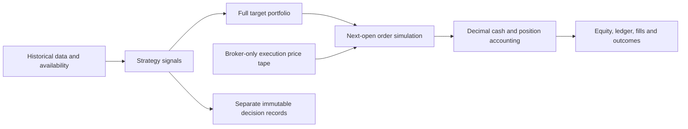

# Deterministic portfolio backtesting

The engine is an offline, shared-cash, spot, long-only simulator. It supports
multiple cryptocurrencies on one exchange, one timeframe per instrument, one
quote currency and allocations to cash. It does not implement trading algorithms,
adaptive selection, optimization, authentication or real orders. Its market
orders are simulated records only.



## Running and integration

```sh
uv sync --locked
uv run --offline --no-sync python -m crypto_research.backtesting.cli demo
```

The deterministic demo uses synthetic bars, a predetermined passive allocation,
1,000 USDT, 10 bps fees and 5 bps adverse slippage. It produces:

```text
Starting capital: 1000.00 USDT
Final equity: 1198.202098 USDT
Total return: 19.820210%
Fees: 0.999001 USDT
Executed trades: 1
```

Use `PreparedData((btc_history, eth_history, ...))` with existing `MarketData`
records to validate and index an in-memory tape once. Pass it to
`run(data, targets, settings)` for each configuration. `SimulationSettings`
requires experiment identity, a UTC `Period`, starting capital and explicit fee
and slippage basis points. No production default implicitly assumes zero costs.

A `PortfolioTarget` is a full portfolio instruction containing `Instruction`
records that pair existing `StrategyConfig` and `TargetExposure` contracts.
Instructions share a decision and effective timestamp. Each market appears once,
weights are finite/nonnegative and sum to at most one. Omitted markets target
zero, and the remaining allocation is cash. Targets must be supplied in strictly
increasing decision order with nondecreasing eligibility; duplicate/contradictory
decisions and targets that collide at a deferred execution open fail explicitly.

`targets_from_batches(batches)` groups precomputed `SignalBatch` records by their
decision/effective timestamps, retaining configurations and source dataset
references. `replay_targets(strategy, snapshots)` calls the existing
`strategies.base.reconstruct` interface, then performs the same conversion. There
is no second strategy protocol. A caller combines synchronized market signals
into a full target; an isolated single-market target liquidates omitted holdings.
Strategies receive only validated snapshots, never accounts or the execution tape.

The engine checks every signal's last data close against the tape and requires
that source candle to have been available by the decision. Supplied dataset
references must match the tape vintage. As with all precomputed research inputs,
metadata alone cannot prove that arbitrary strategy code avoided hidden future
inputs. Strategy behavioral tests and point-in-time snapshot construction remain
required. Existing causal contracts have not changed.

## Timing and execution

The simulation period includes valuations at both boundaries; executions require
an open strictly before its end. Warmup candles before the start may establish
decision history, but decisions outside the simulation period are rejected.

Two event types are distinct:

- **Completed-candle publications:** the full OHLCV record becomes usable at its
  `available_at` timestamp, never earlier than its exclusive close.
- **Broker opening quotes:** the simulator consumes a bar's open at `open_time`
  as an execution/valuation quote. This does not expose its future high, low,
  close or volume to a strategy.

At a shared timestamp, published closes are processed, opening quotes establish
current prices, eligible rebalance instructions execute, then valuation is
recorded. An instantaneous decision at a prior exclusive close can execute at
the adjacent bar's open at that same timestamp. This is an explicit zero-latency
boundary convention, not execution at the source candle's closing price. Set a
later `effective_at` when latency matters; an instruction arriving after an open
waits for a subsequent opening quote.

For each target, select the earliest **common** opening timestamp across the
prepared universe at or after `effective_at`. Existing signal validation also
enforces `data_through <= generated_at <= effective_at`, so the source candle's
own open cannot be used. A missing exact open can defer execution, subject to
`max_execution_delay_seconds` (default one day). Set it to zero to reject missing
exact openings. No eligible common open within that delay and period produces
an explicit rejected `TargetOutcome`, with no invented price or fill.

Requiring a common open keeps rebalances synchronous and deterministic even with
different timeframes/availability. It is deliberately conservative: a missing bar
in an unallocated universe market can defer the whole rebalance. Asynchronous
per-venue execution is a future extension, not simulated implicitly here.

## Decimal accounting and costs

Financial operations use an independent 60-digit Decimal context with round-half-
even arithmetic. Candle floats and existing signal weights cross the boundary via
`Decimal(str(value))`, never binary `Decimal(float)`. This preserves the supplied
float's decimal representation; it cannot recover precision absent from the
source contract. Serialized financial results are decimal strings.

Asset quantities use 18 decimal places rounded down. Cash, notional, fees, market
values and released cost basis use 18 places rounded half-even. Starting capital
is quantized once; capital below one quote unit after rounding fails. Reference
prices must be in `[1e-18,1e18]`, quantities at most `1e18`, and starting capital
at most `1e18`. Unsupported precision/magnitude fails instead of silently using
uncontrolled float arithmetic. Direct orders with off-grid quantities or zero
rounded notional are rejected. These are simulation precision rules, not Binance
tick sizes, lot sizes or minimum-notional filters.

Adverse execution prices are `open*(1+slippage_bps/10000)` for buys and
`open*(1-slippage_bps/10000)` for sells. Fees are the configured fraction of
execution notional on **both** sides, paid in the quote currency. Slippage is
recorded separately as the quantity times the adverse price difference. It is
already embedded in cash/P&L through execution price; never deduct it again.
No separate spread model is added on top.

Buys decrease cash by notional plus fees and add that amount to position cost
basis. Sells increase cash by notional minus fees. Weighted-average cost basis
is released proportionally on partial sales; a full sale releases all remaining
basis exactly. Realized P&L is net sale proceeds minus released basis; unrealized
P&L is current market value minus remaining basis. Entry/exit fees therefore enter
P&L exactly once. This is research accounting, not jurisdiction-specific tax-lot
accounting.

At every valuation, equity is cash plus rounded holdings values. The engine
checks `equity - initial_cash == realized_pnl + unrealized_pnl`. Cash and quantities
must remain nonnegative exactly; there is no hidden overdraft tolerance. Quote
rounding error is bounded by half of `1e-18` per rounded component. Every full
fill has one matching ledger entry, a deterministic order ID and a distinct fill
ID. Rejected orders have no cash/position entry and cannot reuse an order ID.

## Multi-asset rebalances

At the common execution open, compute pre-trade equity and desired quantities
from target weights and contemporaneous opening prices. Sell reductions first,
then buy increases in stable market-identity order. If desired purchases plus
costs exceed remaining cash, scale all proposed buys proportionally before order
creation and round quantities down. A small quote-rounding reserve (two quote
units per proposed buy) protects aggregate affordability when scaling is needed.
Unscaled affordable orders receive no such haircut.

The resulting pre-sized orders are filled in full or rejected; proportional
pre-sizing is not a partial-fill/liquidity model. Actual exposures can differ
from target weights because of costs, rounding and subsequent price changes.
No periodic rebalance occurs without a new instruction. Direct account tests
also verify explicit insufficient-cash and insufficient-holdings rejection.

## Valuation and output

Valuation uses only an opening quote already reached in the event stream or a
completed close already published. A delayed old close cannot replace a newer
opening quote. Held positions require prices no older than
`max_price_age_seconds` (default one day), measured from the quote's market
timestamp, not the late publication time. Missing/stale held-asset prices fail
the simulation. Flat positions do not require a fresh quote.

Records occur at market events, decision times, start and end, so valuation
intervals can be irregular. There is no interpolation, fabricated bar or unlimited
stale carry. Period returns use consecutive recorded equities; a zero prior
equity yields `None` rather than an undefined division. Cumulative returns use
actual quantized starting cash. Later statistics must respect elapsed timestamps
rather than treating each event as an equally spaced day.

`BacktestResult` contains settings/experiment identity, deterministic run ID, data
identities, immutable decisions, target outcomes, orders, fills, ledger entries
and chronological equity points. Each point records cash, holdings value, net
equity, period/cumulative returns, position quantities/values/basis/P&L, target
and actual weights, cumulative fees, slippage and executed notional turnover.
Target weights mean the latest announced desired portfolio, including targets
pending eligibility or rejected; actual weights describe simulated holdings.

Gross performance is a separate zero-fee, zero-slippage account following the
same target/execution schedule and sizing policy. It is a counterfactual, not
net equity plus a simplistic sum of costs: costs alter investable quantities and
later compounding. Net-account ledger/fills remain the source of actual costs.
No final liquidation or hypothetical exit fee is imposed without a cash target.

Decisions/configurations retain strategy ID/version, configuration identity,
market, decision timestamp, data cutoff and allocation. Executions link by target
ID; settings identify the experiment. Future realized outcomes are **not** added
to feature/decision-input objects. `shadow=True` labels an independent simulation
with fresh starting capital; it does not debit an active portfolio.

## Benchmarks, VectorBT and tests

`buy_and_hold(data, settings, weights)` supplies one passive initial target.
Empty weights is all cash, one nonzero weight is single-asset buy-and-hold, and
multiple weights provide fixed **initial** allocations that subsequently drift.
Entry waits for completed, available source candles and the same next-open
execution/cost model used for other targets. There is no free first-bar entry or
special zero-cost benchmark path.

The engine is implemented directly to keep accounting, availability and strategy
contracts independent of a third-party portfolio implementation. An optional
independent cross-check uses the documented
[VectorBT `Portfolio.from_orders` API](https://vectorbt.dev/api/portfolio/base/),
with explicit shifted order sizes, opening prices, fees, slippage and disabled
partial fills. A buy-two/sell-two fixture at 200/300, with 1% fees and slippage,
finishes at exactly 1,180.02 USDT in Decimal accounting and agrees with VectorBT
within `1e-9` quote units. Its floating-point arithmetic is a reference, not the
financial precision policy of this engine.

```sh
uv sync --locked --extra reference
uv run --offline --no-sync pytest tests/integration/test_vectorbt_reference.py --no-cov
```

The optional extra pins Plotly below 7 because VectorBT 0.28.5's template import
uses a trace removed by Plotly 7. Without the extra, the reference test skips.
Neither package is imported by the engine. Normal offline tests retain socket
blocking. Hand-calculated fixtures cover constant/rising/falling/alternating
prices, sudden gaps, missing bars, delayed publications, partial and full
liquidation, fees, slippage, multi-asset rotation, high-cost rebalances, stale
prices and deterministic replay. The Binance smoke test stays opt-in and is not
required for backtesting.

## Research readiness and limitations

The engine is suitable for controlled strategy research on validated data with
defensible availability and execution assumptions. Historical REST downloads do
not establish original publication vintages: strict replay before acquisition
still needs prospectively captured vintages or a separately justified explicit
availability model. The simulator does not backdate availability to make trades
possible. Opening quotes on the broker tape are an explicit historical execution
assumption; revised archive prices are not certified contemporaneous order books.

Candle-open execution and fixed slippage omit latency distributions, spreads,
order-book depth, liquidity/volume limits, queue position, partial fills,
market impact, maker/taker tiers, fee tokens, exchange rounding/filter rules,
transfer delays, outages and delistings. An equal-time close/open assumes an
instantaneous decision boundary. Gaps, stale-price limits, synchronization,
turnover, fee/slippage settings and initial entry timing can materially change
reported profitability. These results do not establish live execution readiness.

Prepared input indexes can be reused across runs; processing is chronological
without repeated historical downloads. Event preparation/sorting is `O(N log N)`;
simulation is proportional to events/targets times the small market universe.
Prepared tapes should be treated as read-only. Results retain full immutable
records in memory. Replay snapshots should use a bounded strategy lookback: the
existing protocol validates each supplied snapshot, so repeatedly supplying the
entire growing history would incur quadratic work in caller snapshot generation.
No parallel/distributed framework is introduced.

Future allocation can aggregate `strategy_id × market × target_weight` into one
validated market-level portfolio target while retaining per-strategy attribution
in separate records. This task supports one instruction per market; it does not
implement capital selection, sleeve accounting, optimizer logic, advanced
statistics, experiment orchestration or strategy ranking. Those extensions must
preserve the decision/outcome boundary and shared cash/risk invariants.

## Research export integration

The research layer now records metrics, independent trials and separate causal
inputs/future labels; see [the research guide](research.md). Optional additive
`EquityPoint.pre_execution_equity` and `pre_execution_gross_equity` fields expose
marked account equity before executions at each event, allowing half-open outcome
intervals to include entry costs and exclude end-boundary transactions without
reconstructing portfolio accounting. `BacktestResult.data_gaps` records missing
source candle coverage within the simulated period. Legacy records can still be
read, but labels without exact pre-execution endpoints remain incomplete.
