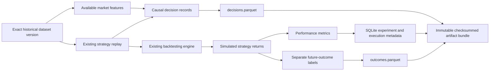

# Research metrics, experiments and datasets

This layer connects exact historical dataset versions, existing strategy replay,
the Decimal backtester, descriptive market features, performance analytics and
local persisted research results. It implements no alpha strategy, model fitting,
parameter search, market-regime classifier, optimizer or live execution.



## Commands and Python entry points

No dependencies beyond the existing locked environment are needed. Research
commands never contact an exchange.

```sh
uv sync --locked
uv run --offline --no-sync python -m crypto_research.experiments.cli run-demo
uv run --offline --no-sync python -m crypto_research.experiments.cli list
uv run --offline --no-sync python -m crypto_research.experiments.cli compare
uv run --offline --no-sync python -m crypto_research.experiments.cli show EXPERIMENT_ID
```

`--root research` and `--data-root data` precede the subcommand when overriding
locations. The demo creates a deterministic synthetic historical dataset in the
data root and evaluates a predetermined one-instruction fixture plus cash and
existing buy-and-hold benchmarks. It emits IDs, status, content identity and
metrics. Repeating it creates new execution attempts without overwriting results.
The default experiment IDs include the declared Git revision prefix.

`run-demo --revision FULL_SHA` supplies a declared code revision, useful for test
fixtures. Otherwise Git HEAD is recorded. A revision is provenance supplied by
the caller, not proof that the working tree matches that revision. Commit code,
retain `uv.lock` and run from a clean checkout for reproducible research; no
automatic working-tree snapshot or source attestation is performed.

The API is `Runner(source_store, registry).execute(spec, strategy=implementation)`
or `.execute(spec, targets=precomputed_targets)`. `ExperimentSpec` requires a
specific `StrategyConfig`, `DatasetReference` including version and checksum,
declared code SHA, explicit simulation settings/costs and training/validation/test
classification. It also records metric assumptions, optional seed, outcome
horizons and data-quality policy. One logical experiment evaluates one strategy
configuration and market independently. Shared multi-asset portfolios can be
analyzed by the metrics API, but are not mislabeled as individual strategy returns.

The runner uses `Strategy` and `reconstruct` through the existing replay adapter.
Publication-time snapshots contain only completed, already available candles and
an explicit fixed 201-calendar-day lookback, sufficient for the initial features.
A strategy that needs more history requires an explicit future runner extension.
No eligible publication during the requested period fails visibly; historical
download availability is never backdated. Empty signal batches mean no emitted
decision, not an invented target. Emit explicit unchanged targets when a full
no-trade decision audit is needed.

## Metric definitions

All returns, weights and drawdowns are decimal fractions: `0.10` means 10%.
Quote-currency fees/slippage are monetary amounts, not percentages. Analytics use
float64 without intermediate rounding; the original financial ledger and exact
Decimal values remain in `result.json` and Parquet string columns. Identical
inputs in the same locked numerical environment produce identical results;
cross-platform floating-point reductions are checked with numerical tolerances.

`summarize(EquitySeries, MetricSettings)` accepts validated UTC equity records.
`from_returns(period, initial_equity, PeriodicReturn records)` compounds validated
simple returns, while preserving absent exposure/gross data as missing.
`from_backtest(result)` adapts existing engine output and binds it to the engine
run identity. Supplying an unrelated ledger/series pair is rejected. Initial
equity is actual quantized starting cash before any entry cost.

For periodic statistics, sample on an explicit grid beginning at the simulation
start, with daily or four-hour spacing. At each boundary take the most recent
valuation at or before it, subject to `max_valuation_age_seconds` (default one
day). Never read a later valuation. Missing/stale boundaries invalidate periodic
statistics rather than dropping bad periods or replacing them with zero. A final
partial interval contributes to total return and elapsed-time CAGR but not to
fixed-frequency risk/average-return estimates. Counts and undefined reasons make
this distinction visible. This is bounded equity valuation sampling, not filling
raw market candles or market features.

Let `V0` be starting cash, `Vi` sampled equity, `ri=Vi/V(i-1)-1`, `N` the number
of complete intervals, `Y=365.25*86400` seconds, and `P=Y/interval_seconds`.
Thus `P=365.25` for daily and `2191.5` for four-hour crypto observations.

| Metric | Definition |
| --- | --- |
| Total net return | Fresh final equity / `V0` minus one |
| CAGR | `(V_end/V0) ** (Y/actual_elapsed_seconds) - 1` |
| Arithmetic periodic mean | `mean(ri)` |
| Geometric periodic mean | `exp(mean(log(1+ri)))-1`; a terminal -100% return gives -100% |
| Annualized volatility | Sample standard deviation of returns (`ddof=1`) times `sqrt(P)` |
| Risk-free periodic rate | `(1+risk_free_annual) ** (1/P)-1`; annual rate is effective and must exceed -100% |
| Sharpe | `mean(ri-rf_period) / sample_std(ri) * sqrt(P)` |
| Downside deviation | `sqrt(mean(min(ri-rf_period,0)**2)) * sqrt(P)`, including zero shortfall for other observations |
| Sortino | `mean(ri-rf_period) / periodic_downside_deviation * sqrt(P)` |
| Maximum drawdown | Largest `1 - equity/running_peak`, including initial cash as the first peak |
| Drawdown duration | Longest elapsed time from the last peak to recovery, or to the last observed/bounded final valuation for an unrecovered episode |
| Calmar | CAGR / maximum drawdown |
| Historical VaR 95% | Negative linearly interpolated 5th percentile of periodic net returns |
| Historical CVaR/ES 95% | Negative average of the worst 5% of empirical return mass, with fractional weight on the boundary observation |

Drawdown is measured on all original equity events, not just the risk grid. No
intrabar high/low path is reconstructed. Cumulative return is each observed
equity / `V0` minus one. The analytics API returns that curve; persisted summary
JSON omits the duplicated curve (`cumulative=null`) because exact net/gross
cumulative series are retained in `performance.parquet` and `result.json`.

VaR is an interpolated historical percentile; ES integrates the discrete empirical
tail. Fractional tail mass avoids diluting a loss with every zero-return cash
observation tied at the threshold. For forty returns containing one -20% loss and
39 zeros, VaR is zero while the worst 5% comprises two observations and ES is
10%. Gains-only samples may have negative loss VaR/ES; results are not clamped.

Known cash periods retain zero returns and zero exposure. Unprovided exposure or
position information stays undefined, rather than being inferred as cash. Cash does not earn the
risk-free rate unless the backtester explicitly models it. Risk-free is the
comparison/minimum acceptable return for the ratios. Nonzero risk-free can
therefore penalize cash. No Gaussian tail assumption is made.

Empty input, missing endpoints, insufficient observations, CAGR overflow, zero
equity denominators and undefined ratios produce `None` plus a structured reason.
At least two returns are needed for sample volatility and Sharpe. Sharpe/Sortino
denominators at or below float64 epsilon times `max(1,abs(mean_return))` are treated
as numerically zero. Zero downside or drawdown never yields an infinite ratio.
Defined zero volatility/drawdown remains zero; undefined values are never zero-
filled. After a zero-equity observation, subsequent undefined periodic returns
invalidate the periodic return vector. Total return/CAGR can still describe ruin.

Trading efficiency uses actual fills/ledger records: total quote fees, modeled
slippage, fill count and one-sided turnover `sum(execution_notional)/initial_cash`.
Time in market and average exposure are elapsed-time-weighted, left-observed
values with bounded carry, not unweighted averages of irregular event rows.
Gross performance is the existing engine's comparable zero-cost counterfactual;
cost drag is gross total return minus net total return. Fees/slippage already
affect equity and are not deducted again. The weighted-average position ledger
does not define unique completed trade lots, so win rate, average completed-trade
return and profit factor are deliberately not inferred.

## Registry, identity and lifecycle

`research/experiments.sqlite` uses schema version 1 (`PRAGMA user_version`), foreign
keys, uniqueness constraints, indexed strategy/market/timeframe/period metadata
and indexed experiment/execution status. It stores immutable full specs, logical
creation times, each run's UTC lifecycle times, status, failure reason, content
identity and artifact/checksum references. SQLite transactions govern publication
of a completed execution and its seven artifact references.

Three identities are distinct:

1. A caller-provided logical `experiment_id`, with an immutable canonical spec.
   Re-registering exactly the same spec is idempotent; any change requires a new
   ID. This is stronger than immutability only after starting.
2. An execution `run_id`, a fresh UUID for every attempt. Created attempts may
   become running, failed or cancelled; running attempts may complete, fail or
   cancel. Terminal states cannot be restarted in place. Lifecycle transitions
   use conditional updates to avoid overwriting a concurrently changed state.
3. Physical artifact identities: checksums of files and the registered manifest.
   `content_id` additionally hashes normalized backtest/metric/decision/outcome
   results with execution UUIDs omitted, allowing repeated runs of the same trial
   to compare equal without overwriting one another.

`input_hash` excludes only operational experiment naming and the matching name
inside simulation settings. It includes strategy/version/parameters, exact source
reference, declared code revision, execution settings, metrics and label policy.
The deterministic engine run ID remains separately stored in the backtest result.
Creation timestamps and execution UUIDs do not enter numerical calculations.

Artifacts publish before completion. A staging directory contains all files,
which are flushed and renamed together. Full verification checks file hashes,
schemas, identities and table/JSON agreement; it recomputes metrics and outcomes
from saved simulated equity. Only then does one transaction insert references and
mark the run completed. A database failure rolls back both. An orphan published
directory can remain after a crash/failed commit, but it is never promoted to
success automatically. Hashes detect inconsistency, not malicious source forgery.

Failed/interrupted attempts remain visible. A new attempt gets a new UUID.
For an abandoned created/running run, explicitly execute:

```sh
uv run --offline --no-sync python -m crypto_research.experiments.cli recover RUN_ID
```

This records cancellation with an interruption reason. It is an administrative
recovery operation, not a worker controller; do not recover an active run. No
automatic startup cancellation or filesystem-based success inference is used.

## Artifact schemas and access

```text
data/versions/SOURCE_VERSION/       # original market data, unchanged
research/
  experiments.sqlite
  artifacts/RUN_ID/
    manifest.json
    spec.json
    result.json
    metrics.json
    decisions.parquet
    outcomes.parquet
    performance.parquet
    trades.parquet
```

The three JSON payloads and four Parquet tables are the seven referenced files;
the manifest is independently checksummed in SQLite. All payload/schema versions
are explicit. Parquet metadata records schema version 1 and table kind. Common
typed columns include experiment/execution, strategy/version/config hash,
exchange/pair/timeframe, exact dataset version/checksum and `simulated=true`.
Timestamps are UTC microseconds; descriptor/risk numbers are float64; exact
financial amounts are canonical decimal strings, avoiding decimal128 overflow or
silent precision loss. Zstandard and 4096-row groups support predicate filtering.

| Table | Contents |
| --- | --- |
| decisions | One emitted decision per experiment/config/market/time; last data time, actual availability, eligibility, target, strictly preceding exposure, signal strength, eight nullable feature columns/missing reasons and a validated complete causal record |
| outcomes | Separate decision-linked half-open horizons, status, gross/net simulated returns, quote costs, exposure and standalone scope; null values for incomplete windows |
| performance | Simulated position/target, cash/equity, period return and start, availability, cumulative returns, per-event and cumulative fees/slippage/turnover |
| trades | Actual fills, decision/eligibility/execution times, quantity, prices, notional and costs linked to order/fill/target metadata in the saved engine result |

The first performance event has no elapsed return period, so its period start and
period return are null. The first elapsed return uses starting capital, rather
than the already cost-reduced first event equity, so compounded exported returns
include the initial entry cost. Later returns compare consecutive post-event
equities. Entry costs remain visible as event costs; outcome labels separately
use pre-execution half-open endpoints. Cumulative cost columns are named
explicitly; do not sum them across rows. No future return columns exist in the
decision table or input types. Unknown fields/table kinds and incompatible
schemas are rejected.

Use `ResearchStore.table(run_id, kind, expected_sha=execution.manifest_sha256,
strategy_id=..., pair=..., exchange=..., timeframe=..., start=..., end=...)` for
filtered reads. Date ranges are half-open and filters must be timezone-aware.
The registered manifest/file checksums are scanned before predicate decoding.
Full semantic verification occurs at completion and `show`; filtered reads avoid
re-decoding unrelated result JSON/tables. Registry comparisons read small,
independently checksummed metric summaries instead of the complete equity files.

`research/` and `data/` are excluded from Git. Keep custom roots outside version
control or add their ignore rules. No cloud/database service or exchange
credentials are required. Interrupted staging directories are not complete runs.

## Observable features and causal records

Feature schema/calculation version 1 uses only completed and available candles.
At an eligible cutoff, the anchor is the most recent available close. A source
older than one native interval is explicitly stale. Day windows are calendar
durations expressed in native bars: one daily bar or six four-hour bars per day.
Thus the 50-day SMA uses 50 daily or 300 four-hour closes, not fifty four-hour
observations. Parameters, timeframe, schema/version, source cutoff and actual
availability are retained.

The initial descriptors are price returns over 7/30/90 days (requiring the anchor
and the exact prior endpoint), sample standard deviation of 30 days of log
returns annualized by `sqrt(365.25*bars_per_day)`, close/50-day-SMA minus one,
close/200-day-SMA minus one, current decline from the trailing 30-day close peak,
and mean reported candle volume over 30 days. Drawdown is a positive magnitude;
volume retains provider/native-bar units. These are descriptive features, not
trading signals or regime classifications.

Windows must be contiguous. Insufficient history, missing intervals and stale
data have explicit missing reasons; no backfill, future read or zero imputation
occurs. An available feature has the existing `MarketFeature` type and availability
equal to the latest publication among its inputs. The cache is keyed by exact
dataset version and cutoff, checks checksum/source identity even on cache hits,
and reuses calculations across strategies.

`DecisionRecord` links the logical experiment/input hash, execution, full strategy
configuration, existing `TargetExposure`, exact dataset and `FeatureSnapshot`.
Its stable decision ID omits execution UUID. Information availability must be no
later than the decision. Preceding exposure uses a strictly earlier equity event,
never the post-execution exposure at the same timestamp. Missing features stay
missing. Existing `DecisionInputs` and the new causal records reject outcome
objects/extra future fields. This type boundary does not sandbox arbitrary Python
strategy code or prove truthful upstream availability metadata.

## Strategy outcomes and shadow histories

Labels are generated from completed **simulated strategy equity**, never future
coin-price returns. A horizon starts at the signal's eligibility timestamp and
ends 1, 7 or 30 calendar days later by default. Both endpoints must have recorded
pre-execution net/gross equity. The half-open interval includes start executions
and costs, excludes end executions/costs, and honors subsequent decisions of that
same stateful strategy; it does not freeze a hypothetical single trade.

Two optional, backward-compatible `EquityPoint` fields record pre-execution net
and gross equity after contemporaneous price marking. They avoid reconstructing
accounting or including an end-boundary exit fee accidentally. Old result files
without these fields produce incomplete labels rather than inferred values.
`BacktestResult.data_gaps` additionally preserves source candle coverage gaps.

Gross/net labels are endpoint equity ratios minus one. Fees and modeled slippage
are sums of fills in `[start,end)`, and average actual exposure is time-weighted
over recorded simulated positions. Exact Decimal cost prefixes and exposure
integrals avoid rescanning every future window. Coverage gaps in source candles
or simulated performance, absent endpoints, and horizons beyond the simulation
end remain incomplete. Zero starting equity has an explicit undefined status.
Incomplete rows have null returns/costs and are never assigned a complete label.
Valuation and execution assumptions, including bounded stale marks, remain those
of the recorded backtest; a complete label is complete under that model.

Scope distinguishes standalone shadow simulation from other standalone simulated
research. The initial runner deliberately rejects shared-portfolio attribution
as individual strategy outcomes. Independent strategy curves must not be summed
to assert an executable combined portfolio; shared capital/netting requires the
future combined allocation/backtesting layer.

`validate_label_split(training, evaluation)` rejects overlapping half-open outcome
intervals across proposed folds. Comparison reports separately flag overlapping
evaluation periods, which are normal for side-by-side backtests but not evidence
of independent tests. Future training builders must use complete labels, purge
overlapping windows and apply any required embargo; no predictive model/training
dataset join is implemented here.

## Comparison, reproducibility and limits

`compare(registry)` returns a Pandas table of strategy/config, market/timeframe,
returns/CAGR, Sharpe/Sortino/Calmar, drawdown/CVaR, fill count, total costs, exposure
and execution status. Failed/cancelled trials remain visible with absent metrics.
Rows are not ranked and no winner is declared. The comparison group includes
dates, source version/checksum, market, declared code, costs, capital, execution,
sampling and evaluation/label policy. Different groups are not directly
comparable. Overlapping evaluation dates are flagged explicitly.

Reproduce a trial with its immutable spec, exact source version, declared source
revision and locked dependencies; a new attempt has distinct operational IDs but
matching normalized result content. Source and feature indexes are reused within
a runner. Return/label construction uses bounded scans, binary searches and
prefix sums; no growing-history quadratic scan or distributed execution is used.
Full integrity audits are linear in artifact size. Full engine results and
feature snapshots remain in memory and snapshots are duplicated for audit in
decision artifacts; this favors correctness over very large-scale storage.

The source store must retain the referenced original version. A cached runner
holds the previously authenticated immutable data in memory; a new runner audits
files again. No `latest` pointer silently substitutes revised observations.
Declared Git SHAs and hashes are provenance, not proof of code cleanliness,
authentic vendor publication times or malicious-storage protection.

The platform can implement and evaluate a first real algorithm under explicit,
defensible data-availability and execution assumptions. Historical REST still
cannot establish original publication vintages; strict replay before acquisition
requires captured vintages or an explicitly justified availability model. Short
samples, overlapping labels, repeated trials, multiple comparisons, selection
bias, nonstationarity, optimistic execution and tail-estimator uncertainty remain
material limitations. No significance, live profitability, strategy promotion or
deployment claim is made.
